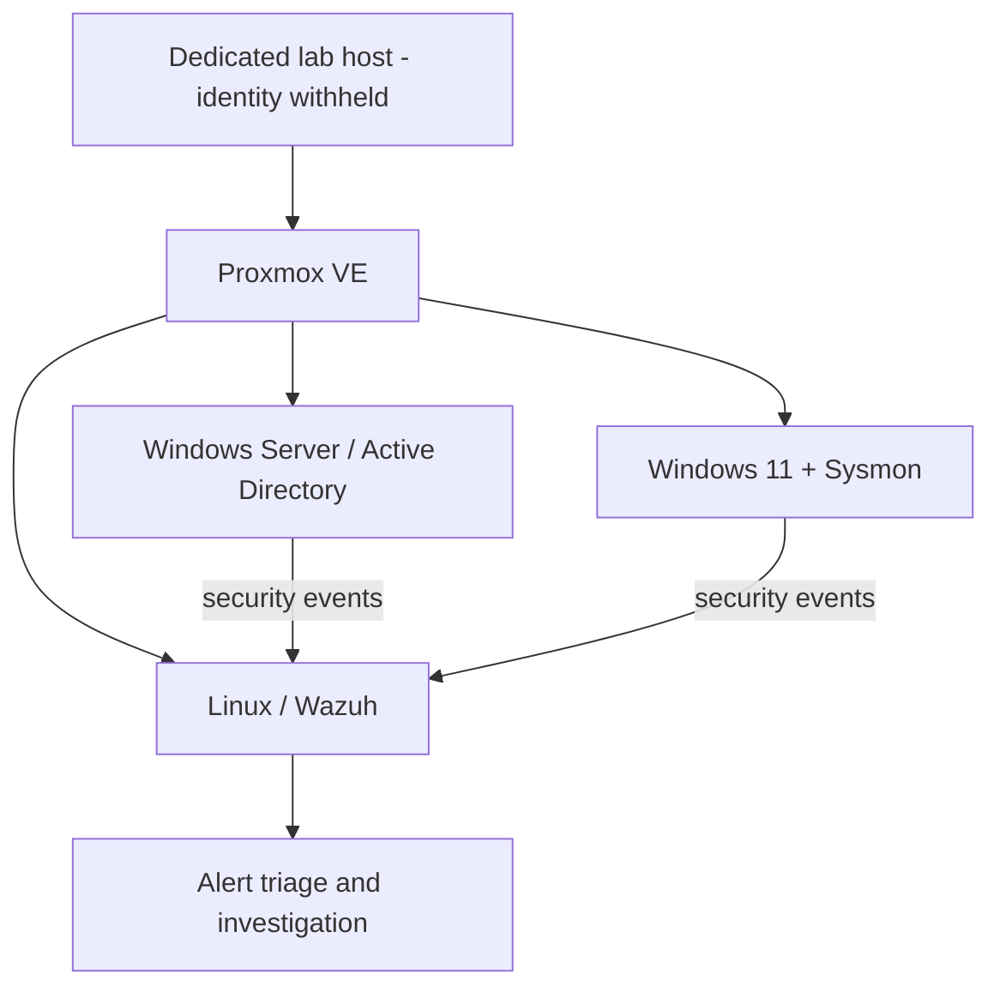

# Enterprise SOC Home Lab — Proxmox · Windows · Wazuh

**Ismail Amoud** | Ottawa, Canada | Junior SOC Analyst / Blue Team

> **FR :** Documentation d'un laboratoire personnel de cybersécurité, et non d'une expérience professionnelle en SOC. Les informations de configuration sensibles et les preuves non anonymisées sont volontairement exclues.
>
> **EN:** Personal cyber-defense home-lab documentation, not professional SOC employment. Sensitive configurations and unredacted evidence are intentionally omitted.

## Architecture / Public topology

The diagram shows **logical roles only**, not real network paths or exposure. [Architecture details](architecture/README.md).

## Eight documented projects

| # | Project | Main focus |
|---|---|---|
| 01 | [SOC Lab Architecture with Proxmox](01-proxmox-architecture/README.md) | Debian, Proxmox, storage and virtual networking |
| 02 | [Linux Hardening and SSH Security](02-linux-hardening/README.md) | sudo, ED25519, SSH hardening, Fail2Ban |
| 03 | [Windows Server and Active Directory](03-active-directory/README.md) | Windows domain and endpoint integration |
| 04 | [Wazuh SIEM Deployment](04-wazuh-siem/README.md) | SIEM components and Windows agents |
| 05 | [Sysmon and Security Monitoring](05-sysmon-monitoring/README.md) | Windows telemetry and log ingestion |
| 06 | [RDP Failed Logon Investigation](06-rdp-investigation/README.md) | Windows Event ID 4625 and Wazuh triage |
| 07 | [MITRE ATT&CK Mapping](07-mitre-attack-mapping/README.md) | Contextual T1110 hypothesis and reporting |
| 08 | [End-to-End SOC Case Study](08-soc-case-study/README.md) | Cross-project synthesis, not a new exercise |

These eight case studies group **20 documented lab milestones**. The eighth project summarizes existing work and is not claimed as an additional performed lab.

## Featured SOC investigation

The [RDP Failed Logon Investigation](06-rdp-investigation/README.md) documents a review of **15 Windows Event ID 4625** records observed in the lab timeline, with Wazuh rule **60122** and possible MITRE ATT&CK mapping **T1110 (Brute Force)**. These failures alone **do not prove a successful compromise**.

## Evidence status

The reported work is based on the existing lab timeline and portfolio documentation. **No raw log exports, executed query transcripts or authentic dashboard screenshots have yet been uploaded** to this public repository. Conclusions and limitations are distinguished in each project. To add verified and redacted proofs later, use the [evidence template](docs/EVIDENCE-TEMPLATE.md).

## Public disclosure policy

Please read [SECURITY.md](SECURITY.md) before uploading further materials. Do not publish infrastructure IPs, private keys, usernames, internal domains, detailed firewall exposure, hosting-provider identifiers or confidential training/exam content.

## Related links

- [Cybersecurity portfolio](https://ismailamoud-cyber.netlify.app)
- [GitHub profile](https://github.com/Ismail-Amoud)
- BTL1 (Centri) and Google Cybersecurity credentials are presented on the portfolio.
- Microsoft SC-200 is **in preparation**; no SC-200 exercise is represented here as completed.

---

*This repository records hands-on learning, with an explicit separation between documented observations, analytical hypotheses, and evidence still to be added.*
