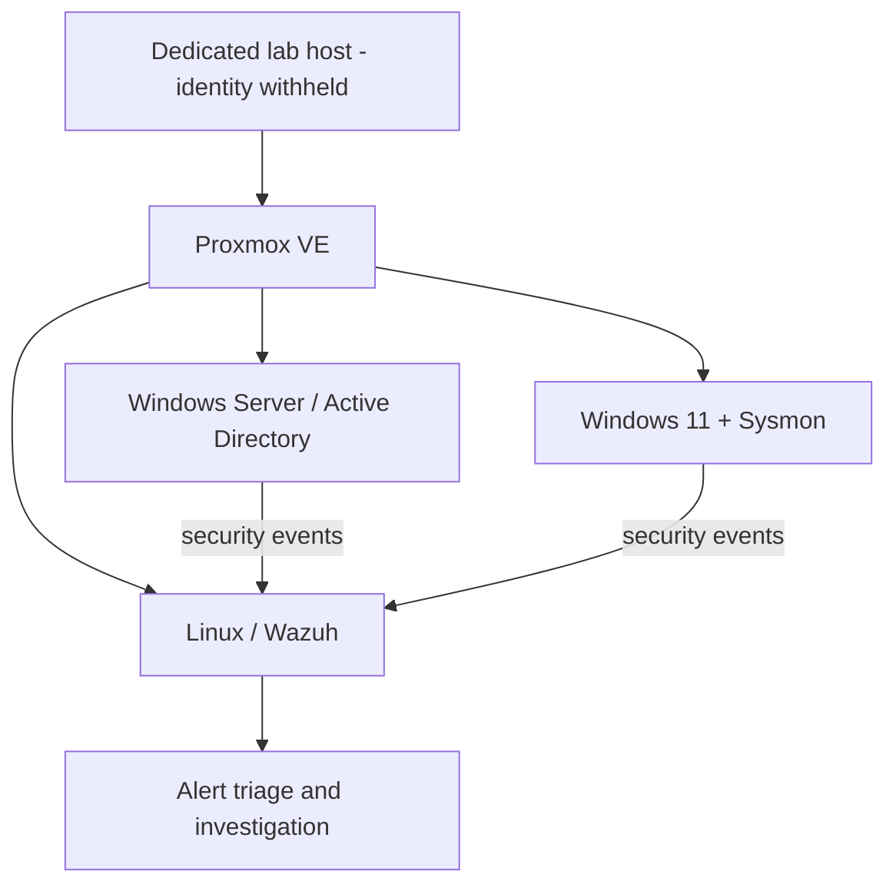

# Public SOC Lab Architecture

This is a **logical and intentionally simplified** representation of the personal Proxmox/Wazuh laboratory. It is **not** a production network diagram or a disclosure of actual routing or exposure rules.

**What is intentionally excluded:** hosting-provider identity, network ranges, VLAN IDs, routing details, internal labels, management interfaces, credentials and exposed services.

[Back to repository](../README.md)
